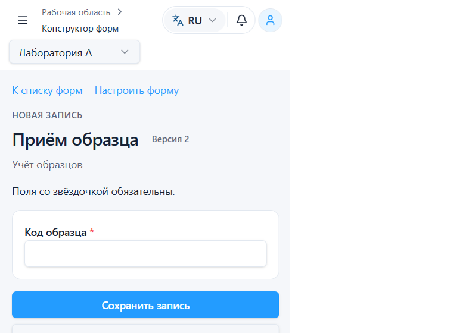
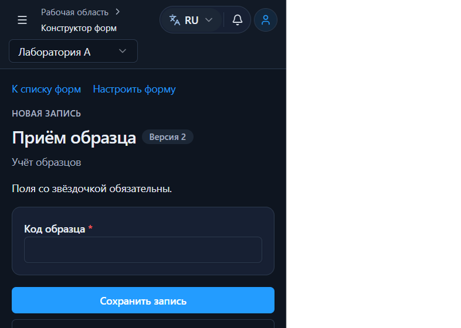
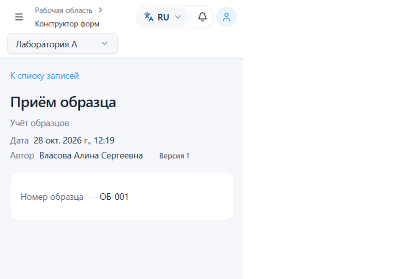
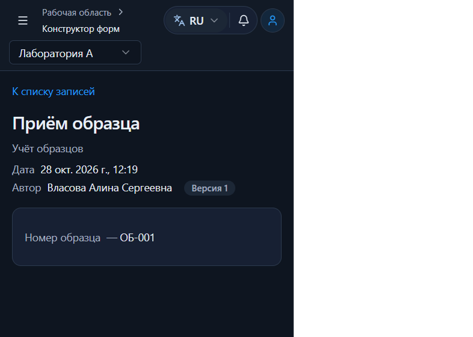
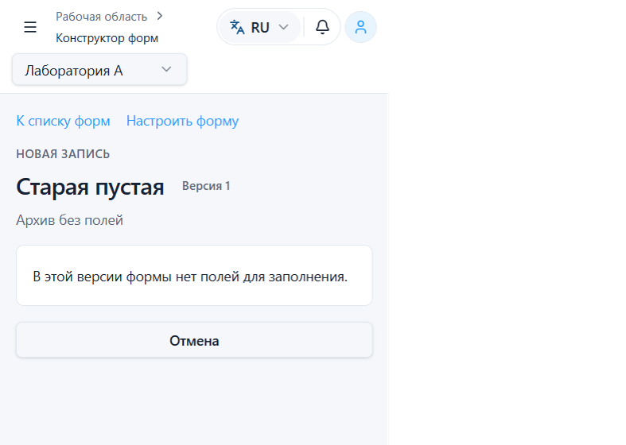
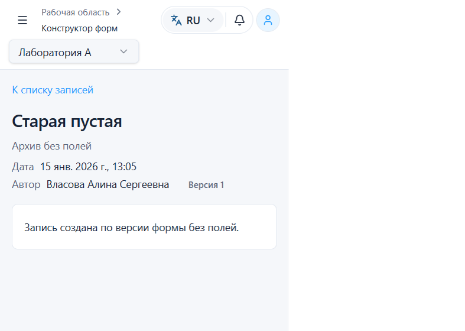
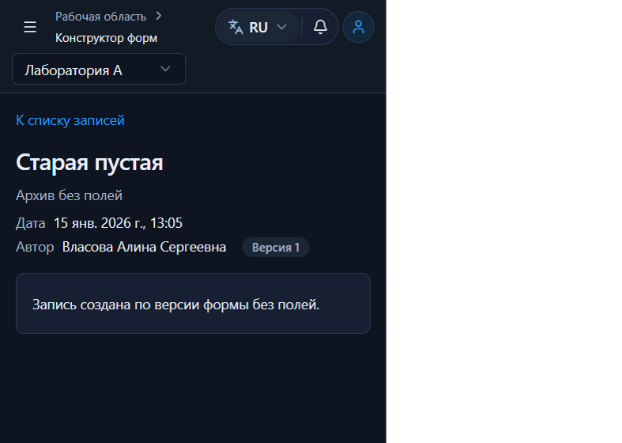
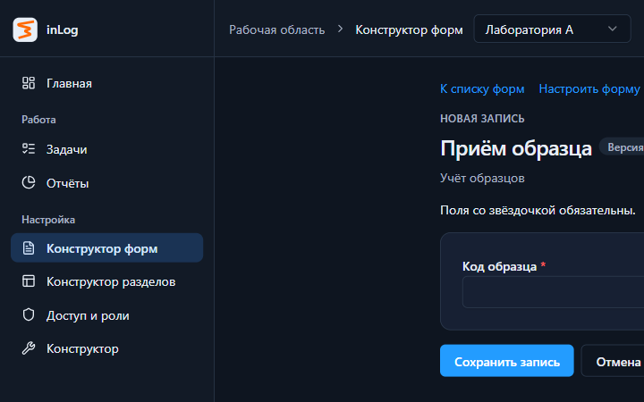
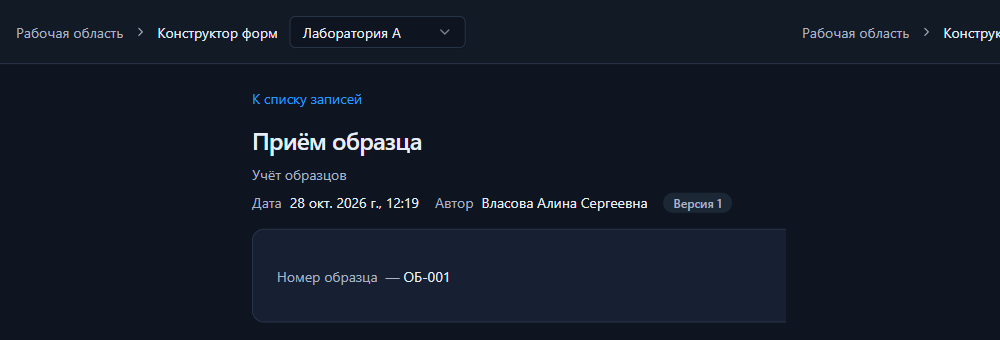

# Заполнение формы и просмотр записи

## Причина

Публикация и создание записи принимали схему с `fields: []`. `validateAnswers` для пустой схемы и пустого объекта ответов возвращал успех, поэтому сохранялась запись без значений. Экран заполнения рисовал `FormRenderer` по пустому списку и активную кнопку «Сохранить запись». Карточка записи показывала дату, автора и версию и пустой рендерер без объяснения.

Ссылка возврата стояла у края страницы, а колонка формы была отцентрована (`max-w` 760). Форма с классом `contents` делала кнопку прямым flex-элементом колонки, и на desktop она растягивалась на всю ширину.

## Что изменено

Черновик без полей по-прежнему сохраняется. Публиковать схему без полей ввода нельзя. Сообщение: «Добавьте хотя бы одно поле перед публикацией». Проверка стоит в редакторе до запроса и в mock-сервисе публикации, включая прямой вызов. Уже выпущенный пустой снимок той же ревизии черновика не удаляется и не переписывается.

Заполнение опубликованной версии без полей показывает «В этой версии формы нет полей для заполнения» и не предлагает создать запись. Создание записи по такой версии, в том числе уже не текущей, отвечает `400` и не пишет в хранилище. Старая пустая запись открывается с текстом «Запись создана по версии формы без полей».

Код ошибки: `empty_schema`. Формат тот же, что у остальных отказов mock-сервиса: `{ code }`. Для публикации это `400`. Правило описано в `docs/stage-3b/api-contract.md` как контракт mock для будущей реализации backend. Live его не исполняет.

Поле ввода — тип из существующего `FORM_FIELD_TYPES`. Отдельного декоративного типа в модели нет и он не добавлялся. Тип вне этого списка не считается полем ввода.

Необязательное пустое значение остаётся допустимым. Отдельного правила «хотя бы одно непустое значение» нет. `0` и `false` не отбрасываются. `Boolean(value)` как общая проверка заполненности не используется.

Редактор работает с черновиком. Если черновик грязный, публикация сначала сохраняет его и при ошибке сохранения не публикует. Заполнение берёт опубликованную версию. Запись открывается по своей версии и подписям снимка. После версии 2 запись версии 1 сохраняет исходную подпись и значение.

Экран заполнения остаётся в оболочке приложения. Ссылка возврата, заголовок и карточка стоят в одной колонке `WorkPage` шириной `form` (до 760 px, внутри запрошенных 760–880). На desktop «Сохранить запись» обычной ширины, «Отмена» — ссылка, которую перехватывает существующий leave guard. На ширине 390 кнопка на всю ширину колонки. Служебные идентификаторы не показываются. Сетевая ошибка не превращается в «нет полей». При смене формы или организации компонент монтируется заново и не показывает поля предыдущего контекста.

Карточка записи — документ: название, описание, дата, автор, версия и пары «подпись — значение». Обязательность на документе не помечается. Режим задаётся уже существовавшим `presentation` у `FormRenderer`. Заполнение и предпросмотр этот режим не передают и остаются полями ввода. Пустое значение — «—». `0`, `false`, дата и подпись варианта списка сохраняются.

«Настроить форму» видна при `forms.update`. Ссылка возврата по-прежнему принимает только `returnTo` внутри раздела той же организации. Произвольный внешний URL не подставляется. Права, owner-политика, делегирование, рабочий контекст, writer lock, namespace и модель хранения записей не менялись.

В `FormEditor.tsx` заодно исправлена уже существовавшая ошибка `tsc`: список мобильных панелей собирался через `concat`, и литерал `'field'` не входил в тип `'fields' | 'preview'`.

## Файлы

- `src/entities/form/model/schema.ts` — `isInputField`, `hasInputFields`, `empty_schema` в `parseSchema` для режима публикации
- `src/entities/form/model/display.ts`, `display.test.ts` — формат значения, экран заполнения, разрешение отправки, идентификатор созданной записи
- `src/entities/form/model/rules.test.ts`, `src/entities/form/index.ts`
- `src/entities/form/ui/FormRenderer.tsx` — документ только при `presentation`
- `src/app/mocks/forms/service.ts`, `service.test.ts`
- `src/features/form-builder/ui/FormEditor.tsx`
- `src/features/form-fill/ui/FormFill.tsx`, `FormRecordView.tsx`
- `src/pages/app/forms/ui/FormFillPage.tsx`, `FormRecordPage.tsx`
- `src/shared/i18n/locales/ru.json`, `en.json`
- `docs/stage-3b/api-contract.md`

## Проверки в тестах

`npm test`: 40 файлов, 174 теста, все прошли.

Покрыто:

- пустой черновик сохраняется;
- публикация схемы без полей — `400 empty_schema`, состояние хранилища не меняется;
- прямой `createRecord` по старой пустой версии — `400 empty_schema`, новая запись не появляется;
- старая пустая запись читается, чужая организация получает `404` и не видит название;
- повторная публикация той же ревизии пустого снимка возвращает существующую версию;
- обычная форма публикуется и заполняется;
- пустое обязательное поле — `invalid_payload`, запись не создаётся;
- необязательные пустые значения, `0` и `false` сохраняются;
- после публикации версии 2 запись версии 1 хранит подпись «Номер образца» и значение «ОБ-001»;
- ошибка создания не даёт идентификатор для перехода (`createdRecordId`);
- сетевая ошибка при нуле полей остаётся ошибкой с повтором, а не экраном «нет полей»;
- документ не показывает звёздочку обязательности, заполнение и предпросмотр её показывают для обязательного текстового поля.

## Команды

Ветка `refactor/corporate-concept`, HEAD `fc085e9` (`fix: add changes to formEditor`). Commit и push не выполнялись.

| Команда | Результат |
| --- | --- |
| `npm test` | 40 files, 174 passed |
| `npm run lint` | exit 1, 146 problems (120 errors, 26 warnings), как до правки |
| `npm run build` | exit 0, `tsc -b && vite build --mode mock`, около 55 с. Предупреждение о крупном чанке осталось |

Старый долг lint не исправлялся.

## Браузер

Отдельный mock-origin `http://127.0.0.1:5174` (`dev:mock`). Рабочая база `localhost` не сбрасывалась. Вход: владелец, организация «Лаборатория А» (101).

1. Пустой черновик «Приём образца» сохранён. Диалог публикации показал «Первая публикация. Полей: 0».
2. Публикация отказана текстом «Добавьте хотя бы одно поле перед публикацией». Редактор остался на месте, заполнение не открылось.
3. Добавлено обязательное поле «Номер образца», опубликована версия 1.
4. Заполнение показало название, описание, «Версия 1», звёздочку и кнопку сохранения.
5. Пустая отправка осталась на странице заполнения, поле невалидно.
6. Сохранено «ОБ-001». Карточка: дата, автор Власова Алина Сергеевна, версия 1, «Номер образца — ОБ-001». Звёздочки на документе нет.
7. Повторное открытие той же записи, в том числе после перезагрузки страницы, показывает то же значение.
8. Подпись в редакторе изменена на «Код образца», опубликована версия 2. Новое заполнение показывает «Код образца» и «Версия 2».
9. Запись версии 1 по-прежнему показывает «Номер образца» и «ОБ-001». Подписи «Код образца» на ней нет.
10. «К списку записей» открывает `/forms/{id}/records?org=101`, запись в списке есть.
11. На том же origin в IndexedDB вставлена ранее невозможная через новый интерфейс пустая опубликованная версия и запись. Карточка показывает метаданные и «Запись создана по версии формы без полей». Заполнение этой версии показывает «В этой версии формы нет полей для заполнения» и не показывает «Сохранить запись».

Ширина 390: горизонтального overflow нет (`scrollWidth` равен `clientWidth`). Кнопка сохранения на всю ширину колонки. Светлая и тёмная темы проверены на заполнении, карточке и пустой записи.

Ширина 1440, тёмная и затем светлая тема: overflow нет. Ссылка, заголовок и карточка имеют одну левую границу (492). Колонка и карточка 696 px. Кнопка «Сохранить запись» 150 px, не на всю колонку. Полный кадр CDP при эмуляции 1440 склеивал поверхность в повторяющиеся плитки, поэтому в отчёт положены обрезки одной копии. Цифры выше сняты из DOM, а не из картинки.

## Что не проверялось в браузере

- Вход из раздела и возврат по `returnTo`. Этот проход начат из редактора. Правило `acceptReturnTo` не менялось.
- Сотрудник без `forms.update`. У владельца ссылка «Настроить форму» видна, это ожидаемо. Seed и IndexedDB правами не дополнялись.
- Прямой обход интерфейса публикации и создания записи. Это покрыто тестами mock-сервиса. В браузере пустая публикация остановилась в редакторе до запроса.
- Сетевая ошибка сохранения, `0`, `false` и пустое необязательное поле на живой странице. Форма в проходе содержала одно текстовое поле. Эти случаи есть в тестах.
- Чужая организация в интерфейсе. В тесте чтение пустой записи организацией 102 возвращает 404.
- Live backend. Контракт `empty_schema` описан для будущей реализации и mock-сервисом исполняется сейчас.

## Скриншоты

Заполнение, 390, светлая тема:

Заполнение, 390, тёмная тема:

Карточка записи, 390, светлая тема. Подпись версии 1 сохранена после публикации версии 2:

Карточка записи, 390, тёмная тема:

Опубликованная версия без полей, 390, светлая тема:

Старая запись без полей, 390, светлая и тёмная темы:

Заполнение и карточка на 1440, тёмная тема. Кадр обрезан из снимка эмулированного viewport:

