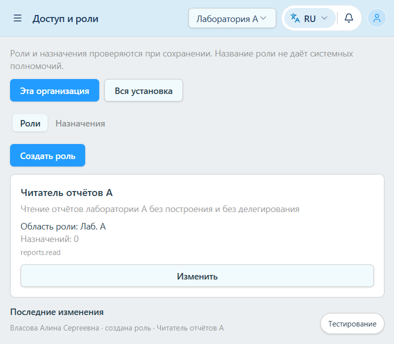
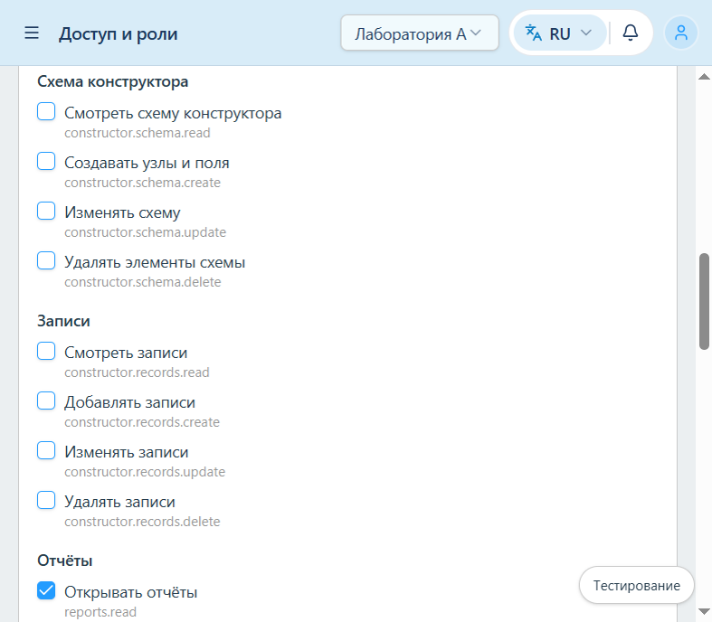
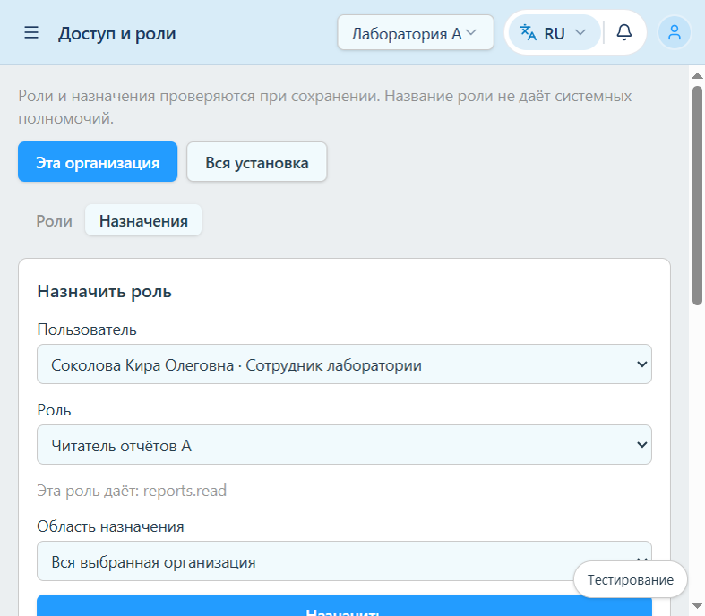

# Этап 3А. Управление ролями, разрешениями и назначениями

## 1. Состояние

- Ветка: `migration/stage-01-auth`
- HEAD: `28c14fcd5bd60b4320033221fb68d857c9a94cf5` (`fix: add changes to tasks & constructor`)
- Commit и push не выполнялись. `reset` и `clean` не выполнялись. Namespace `inlog:mock:corporate-v2` не менялся.
- Незакоммиченная работа этапов 2А и 2Б сохранена. Новые файлы доступа добавлены рядом с ней.

## 2. Модель

Вторая модель доступа не создавалась. Рабочие сущности те же: пользователь, организация, проект, роль, операционное разрешение (`grantIds`), назначение, каталог делегирования (`delegationGrantIds` и записи `DelegationGrant`), системная capability `corporate_superadmin`.

`can()` по-прежнему смотрит только операционные grants и область назначения. `canDelegate()` смотрит делегируемый набор и требует `delegations.delegate`, если набор передаётся дальше. Название роли, `roleId` и лишние поля тела запроса capability не создают.

Расширения минимальные:

- у роли необязательные `description` и `ownerScope`. Пустой `ownerScope` означает роль установки и миграцией не заполняется. Менять такую роль может только корпоративный суперадминистратор;
- `canManageAssignment` пускает суперадминистратора в роли и назначения этой установки. Это административный вход, а не `can() === true` на любой ресурс. Операционный `can()` не изменён;
- создание и изменение роли идут через ту же проверку, что назначение: право управлять областью, каждый выдаваемый операционный grant есть в делегировании действующего лица, непустой набор «может выдавать другим» требует права передавать делегирование дальше и поштучной проверки этого набора;
- область назначения должна покрываться `ownerScope` роли. Корпоративное назначение — это scope `corporation`, его не подменяет одна организация;
- точный повтор `userId + roleId + scope` идемпотентен и не увеличивает `accessVersion`;
- удаление роли с назначениями возвращает `409 role_in_use` и ничего не снимает каскадом.

История `accessAudit` пишется в том же объекте состояния, что и изменение: кто, когда, действие (`role.create`, `role.update`, `role.delete`, `assignment.create`, `assignment.revoke`), роль или назначение, снимки до и после. Токены и пароли туда не входят. Отказ историю не дописывает. Это журнал моков, не промышленный аудит.

## 3. Каталог

Отдельный ресурс `roles` не добавлялся. Управление остаётся на `assignments.update` плюс проверка делегирования.

Редактор предлагает только уже существующие возможности приложения:

| Группа | Действия |
| --- | --- |
| Задачи | read, create, update, delete, assign |
| Схема конструктора | read, create, update, delete |
| Записи | read, create, update, delete |
| Отчёты | read, generate |
| Управление доступом | `assignments.update`, `delegations.delegate` |

Действия независимы. Чтение не включает изменение, изменение не включает создание и удаление, право выдавать другим не даёт выполнить действие. Форма не включает соседние права сама и пишет, где экран их сочетает: раздел конструктора открывает чтение схемы, кнопка отчёта требует чтение и построение, быстрое создание задачи требует чтение и создание.

Разрешения вне этого списка, уже лежащие на старых ролях (`members`, `projects`, `organizations`, `requests`, `test-resource`), сохраняются и могут быть сняты. Новым их добавить нельзя. Оборудование и процессы в каталог не вносились.

## 4. Предлагаемый контракт

Пути ниже — предлагаемый контракт. Они есть только у mock worker (`/mock-api/access/...`) и не отправляются в live.

- `GET /access/directory/?organization={id}` — роли, назначения, кандидаты и проекты одной организации
- `GET /access/directory/?scope=corporation` — роли и назначения установки, только при `corporate_superadmin`
- `POST /access/roles/`
- `GET /access/roles/{roleId}/`
- `PATCH /access/roles/{roleId}/`
- `DELETE /access/roles/{roleId}/`
- `POST /access/assignments/`
- `DELETE /access/assignments/{assignmentId}/`

Кандидат — `id`, `fullName`, `position`. Почта не отдаётся. Администратор организации видит участников этой организации, а не всех пользователей установки.

Коды: `400` `invalid_name`, `invalid_description`, `invalid_grants`, `invalid_user`, `invalid_role`, `invalid_version`, `invalid_organization`; `403` `forbidden`, `self_elevation`, `invalid_scope`, `scope_expansion`; `404` `not_found`; `409` `stale_write`, `role_in_use`, `mock_writer_held`, `writer_lock_unavailable`. Успешный toast при отказе не показывается.

В live страница показывает текст, что управление доступом на сервере ещё не подключено, и запросы не делает. Сетевая ошибка за признак «не реализовано» не принимается.

## 5. Миграция и запись

Документ стал версии 5. Версия IndexedDB осталась 1. Переход с версии 4 добавляет пустой `accessAudit`, если поля не было. Списки grants не расширяются, `ownerScope` не проставляется, пользователи, задачи, комментарии, файлы, конструктор и настройки не заменяются свежим seed. Обычные пользователи новых прав не получают. Capability уже существующего суперадминистратора достаточна, чтобы открыть раздел, без автоматических операционных grants.

Если в браузере нет `navigator.locks.request`, запись не считается защищённой. `update` и `reset` завершаются отказом `writer_lock_unavailable`: замок внутри одного realm не отделяет вкладки. Уже сохранённый документ читается. Пустую базу без этого API создать нельзя.

Своя вкладка после успешной операции пишет IndexedDB, увеличивает `accessVersion` и сбрасывает кэши `AccessControl`, `SessionAccess`, задач и узлов конструктора. Та же вкладка заново читает `session/access` по таймеру 20 с и при возврате на вкладку. Другие вкладки сами не получают событие. Каждая защищённая операция заново читает состояние внутри записи. Смена прав не делает logout: 403 сессию не закрывает. Если снято последнее назначение, остаётся существующий экран `pending`.

## 6. Интерфейс

Пункт «Доступ и роли» добавлен в группу настроек единого реестра навигации. Его видит корпоративный суперадминистратор по capability и пользователь с `assignments.update` в выбранной организации. Старая platform-admin не открывается, `user.role` не используется.

Две вкладки: «Роли» и «Назначения». Организация берётся из текущего контекста. Проект выбирается только в форме проектного назначения. Суперадминистратор переключается на «Вся установка». Администратор организации этой кнопки не видит.

Редактор роли — отдельная страница. Два набора: «Может выполнять» и «Может выдавать другим». Подписи русские, технический код вторичен. Перед сохранением роли с назначениями показывается число людей и видимые области. Удаление назначенной роли выключено и на сервере отвечает `role_in_use`.

## 7. Команды

| Команда | Результат |
| --- | --- |
| `npm test` | exit 0, 28 файлов, 115 тестов |
| `npm run build` | exit 0. Прежнее предупреждение Rollup о размере чанка, крупнейший около 7,98 МБ |
| `npm run lint` | exit 1, 146 проблем: 120 ошибок, 26 предупреждений |

До завершающих правок этапа 2Б было 119 ошибок и 26 предупреждений, в финале 2Б — 120 и 26. Текущий прогон совпадает с финалом 2Б. Добавленная тогда диагностика остаётся в `ConstructorNodeContext.tsx`: `react-hooks/set-state-in-effect` на строке 99, вызов `fetchTableRows()` из эффекта. Файлы выбора узла и writer её не добавляли, отчёт 2Б это уже зафиксировал. Файлы этого этапа отдельных ошибок не дали; `react-refresh/only-export-components` у сводки разрешений убран выносом функции из компонента. Правила не отключались.

## 8. Автоматические проверки

`src/app/mocks/access/service.test.ts` и тесты репозитория:

- имя «Суперадминистратор», `roleId` и лишние поля тела не дают `corporate_superadmin`;
- операционный набор и набор «может выдавать другим» независимы;
- суперадминистратор создаёт и назначает роль с `reports.read` без дальнейшего делегирования;
- лишнее разрешение и расширение scope отклоняются, состояние и история не меняются;
- самоусиление отклоняется;
- правка уже назначенной роли не добавляет право, которого нельзя делегировать;
- чужие `roleId`, `userId`, `organizationId`, `projectId` отклоняются;
- отзыв одного из двух назначений оставляет второе;
- удаление используемой роли получает `409 role_in_use`;
- снятие последнего назначения переводит человека в `pending` и не трогает сессии;
- точный дубликат идемпотентен;
- устаревший `expectedAccessVersion` даёт `409 stale_write` без новой истории;
- роль и запись истории читаются после повторного открытия IndexedDB;
- миграция схемы 4 добавляет пустой аудит и не выдаёт grants, пользователей и `ownerScope`;
- без `navigator.locks.request` запись отвергается, уже записанная версия остаётся;
- `accessManagementMode('live')` равен `unavailable`.

## 9. Браузер

Сценарий шёл на `http://localhost:5178` (`vite --mode mock`). Origin `5173` не открывался и не сбрасывался. Seed и IndexedDB руками не правились. Вход — обычная форма, не переключение тестового аккаунта в обход writer lock.

Суперадминистратор (Власова), организация «Лаборатория А»:

1. Создана роль «Читатель отчётов А»: операционно только «Открывать отчёты», колонка «Может выдавать другим» пустая.
2. Роль назначена Соколовой Кире Олеговне на всю лабораторию А.
3. Вход Соколовой. В навигации появились отчёты, конструктора и раздела доступа нет. Страница отчётов открылась, построение недоступно. Прямой адрес конструктора закрыт: «Для этого раздела нет нужного права. Данные не запрашиваются».
4. Возврат суперадминистратором, отзыв только этого назначения. Назначение «Сотрудник» осталось.
5. Повторный вход Соколовой. Пункта «Отчёты» нет, задачи есть. Адрес отчётов закрыт той же заглушкой, сессия не завершилась.

Отдельно суперадминистратор в виде «Вся установка» открыл роль «Администратор лаборатории». Перед сохранением показано: изменение затронет 1 пользователя и 1 назначение в Лаб. А. В «Может выдавать другим» добавлено только «Открывать отчёты». Удаление роли осталось выключено.

Вход Лебедева:

- кнопки «Вся установка» нет;
- чужая установочная роль по прямому адресу отвечает «Недостаточно прав»;
- в редакторе новой роли доступна только «Открывать отчёты»; «Удалять задачи» и построение отчёта недоступны с объяснением;
- колонка дальнейшего делегирования недоступна: это право ему не передавалось;
- создана и назначена Белову роль «Допустимый читатель» в Лаб. А;
- список людей — участники Лаб. А, без сотрудников лаборатории Б и заказчика;
- адрес `org=102` отвечает «Нет доступа к этой организации».

Повторное открытие страницы на том же origin показало обе роли и назначение «Допустимый читатель» без пересоздания базы. Сохранённая база пользователя на `5173` этим браузером не читалась: профиль инструмента отдельный. Сохранность старого документа проверяет тест миграции схемы 4, без reset.

Снимки синтетических данных:

## 10. Ограничения

- Live-контракт не реализован. Экран честно сообщает, что функция недоступна, и mock handlers не включает.
- Мгновенной синхронизации вкладок нет. Другая открытая сессия увидит новые права при следующем чтении `session/access` (таймер 20 с, возврат на вкладку или собственное действие), а не по push.
- Без Web Locks API запись моков запрещена и не называется межвкладочной защитой.
- Корпоративное назначение в интерфейсе есть только у суперадминистратора и только как scope установки.
- Регистрация, приглашения и кадровая интеграция не делались.
