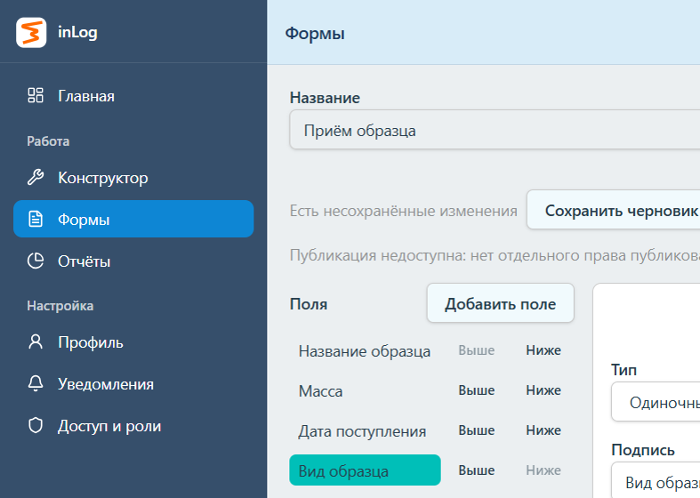
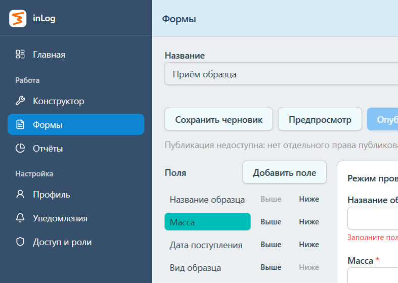
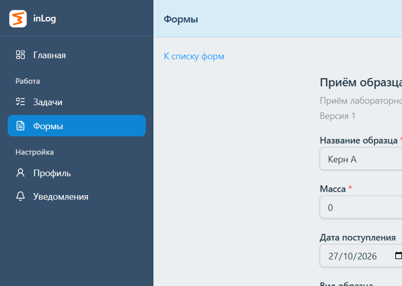
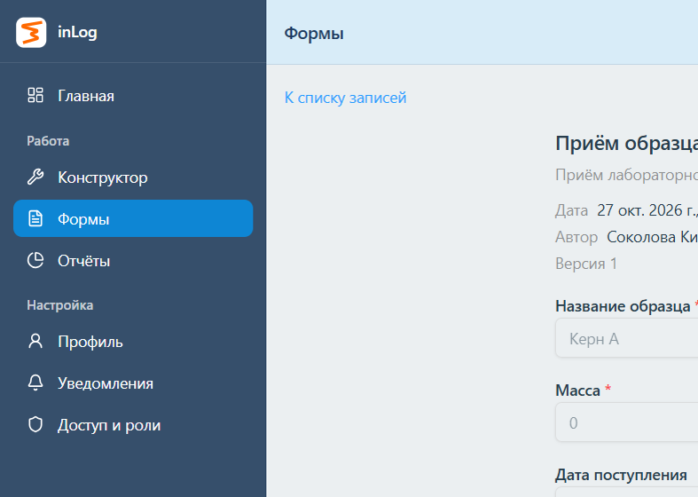

# Этап 3Б. Конструктор форм первой версии

## 1. Состояние

- Ветка: `migration/stage-01-auth`
- HEAD: `ea1727f0850d062c7a88ef3efe5cee1839289c74` (`feat: add new roles model`)
- Commit и push не выполнялись. `reset` и `clean` не выполнялись. Namespace `inlog:mock:corporate-v2` не менялся, рабочая база не сбрасывалась.
- Дерево на старте этапа было чистым. Все файлы ниже — незакоммиченная работа этого этапа.

Граница модели: [form-model.md](form-model.md). Контракт: [api-contract.md](api-contract.md).

## 2. Архитектура

Legacy-конструктор остаётся на `/admin/constructor` и `/admin/reports`, с прежними коллекциями и DTO. Новый пункт меню — «Формы», рядом с «Конструктор».

Новые сущности лежат в том же mock-документе: `forms`, `formDrafts`, `formVersions`, `formRecords`. Значения записи ключуются `fieldId`, вариант выбора — `optionId`. Схема несёт `schemaVersion: 1`. Неизвестная версия не рисуется как первая и не переписывается.

Слои:

- `entities/form` — типы, разбор схемы, валидация ответов, сводка публикации, RTK Query, один `FormRenderer`;
- `features/form-builder` — черновик, настройки поля, предпросмотр;
- `features/form-fill` — заполнение и просмотр записи;
- `pages/app/forms` — список, редактор, заполнение, записи, уход со страницы;
- `app/mocks/forms` — service и MSW. UI repository, seed и handlers не импортирует.

Предпросмотр вызывает только `validateAnswers` и запись не создаёт. Заполнение закрепляет `formVersionId` первого ответа. Повторная публикация той же ревизии черновика возвращает уже созданную версию. Черновик после публикации не затирается снимком.

Live (`VITE_API_MODE` не `mock`) показывает недоступность и запросы форм не монтирует. Mock к реальному backend не ходит.

## 3. Изменённые файлы

Новые:

- `src/entities/form/` — `types.ts`, `schema.ts`, `values.ts`, `summary.ts`, `availability.ts`, `formApi.ts`, `rules.test.ts`, `ui/FormRenderer.tsx`, `index.ts`
- `src/features/form-builder/` — `model/editor-state.ts`, `ui/FormEditor.tsx`, `ui/FieldSettings.tsx`
- `src/features/form-fill/` — `ui/FormFill.tsx`, `ui/FormRecordView.tsx`
- `src/pages/app/forms/` — список, редактор, заполнение, записи, `use-leave-guard.ts`, `FormsBoundary.tsx`
- `src/app/mocks/forms/` — `service.ts`, `handlers.ts`, `service.test.ts`
- `src/app/mocks/db/form-grants.ts`
- `docs/stage-3b/form-model.md`, `api-contract.md`, этот отчёт, скриншоты

Изменённые:

- `src/app/mocks/db/constants.ts` — `MOCK_SCHEMA_VERSION` 6. `MOCK_DB_VERSION` и namespace прежние
- `src/app/mocks/db/types.ts`, `migrate.ts`, `seed.ts`
- `src/app/mocks/handlers.ts`, `constructor/service.test.ts`
- `src/entities/access/model/grants.ts`, `permission-catalog.ts`
- `src/features/access-management/ui/PermissionSets.tsx`, `RoleEditor.tsx`
- `src/app/navigation/catalog.ts`, `catalog.test.ts`, `shell/AppShell.tsx`, `routing/AppRouter.tsx`
- `src/shared/api/platformApi.ts`, `shared/lib/routes.ts`
- `src/shared/i18n/locales/ru.json`, `en.json`

Маршруты форм — соседи оболочки, не страницы админского конструктора: `/forms`, `/forms/:formId`, `/forms/:formId/fill`, `/forms/:formId/records`, `/forms/:formId/records/:recordId`.

## 4. Права и назначения

Коды не добавлены в операционные наборы существующих ролей и не выдаются по названию роли или `corporate_superadmin`.

| Код | Смысл |
| --- | --- |
| `forms.read` | список форм и опубликованная схема для заполнения |
| `forms.create` | создание формы |
| `forms.update` | метаданные, черновик, признак несохранённых изменений |
| `forms.publish` | публикация |
| `form-records.create` | отправка записи |
| `form-records.read` | чтение записей форм этой организации |

`forms.read` черновик не открывает. `forms.publish` не входит в `forms.update`. Область — организация.

На свежем seed коды лежат в каталоге делегирования координатора. Миграция схемы 5 → 6 добавляет пустые коллекции и недостающие строки каталога и не дописывает коды в `grantIds` или `delegationGrantIds` уже сохранённых ролей.

В браузере на `http://localhost:5179` права выданы через раздел доступа, без правки seed и IndexedDB:

- роль «Автор форм» (`role-0d50cd0d-dcdc-4070-8c4d-20b5d24174b3`), область Лаб. А, назначена Лебедеву на всю организацию;
- сначала без `forms.publish`, затем этот код добавлен в операционный набор той же роли и сохранён;
- роль «Сотрудник форм» (`role-076f1b48-a687-445c-b329-016fc9531063`): `forms.read`, `form-records.create`, `form-records.read`, назначена Соколовой на всю организацию;
- набор «может выдавать другим» этими кодами не пополнялся.

Координатор без `forms.read` пункт «Формы» не видит. Попытка назначить «Автор форм» самой себе отклонена текстом о запрете выдать себе право, которого ещё нет. Назначение не создано.

## 5. Миграция и публикация

`MOCK_SCHEMA_VERSION` стал 6. Роли, назначения, задачи, файлы, legacy-конструктор, настройки и история доступа миграцией не переписываются. Старые записи конструктора не получают `formId`.

Публикация проверяет право и схему, создаёт неизменяемую версию и сдвигает указатель текущей версии. Прежние версии и записи не меняются. Повтор той же ревизии черновика вторую версию не создаёт. Если черновик уже есть, опубликованная схема его не затирает.

Новое заполнение идёт по текущей опубликованной версии. Отправка другого `formVersionId` — `409 version_conflict`, введённые значения на экране остаются. Сохранённая запись открывается по своему `formVersionId`.

## 6. Команды

| Команда | Результат |
| --- | --- |
| `npm test` | 30 файлов, 129 тестов, все прошли |
| `npm run build` | код выхода 0 (`tsc -b && vite build`). Предупреждения о крупных чанках прежние |
| `npm run lint` | 146 проблем: 120 ошибок и 26 предупреждений |

Это совпадает с последним baseline (120 ошибок, 26 предупреждений). В выводе lint нет файлов `entities/form`, `form-builder`, `form-fill`, `pages/app/forms`, `mocks/forms`. Правила не отключались.

Автоматические проверки, отдельно от браузера: типы и диапазоны, `0`, `false` и пустая строка; дата без сдвига пояса; стабильные `fieldId` и `optionId`; неизвестные ключи; предпросмотр не пишет запись; черновик переживает повторное чтение и не зависит от опубликованной версии; повтор публикации и конфликт ревизии; запись привязана к версии; запись v1 после v2; конфликт устаревшей отправки; изоляция организаций и отдельных действий; черновик не читается через публичный DTO; миграция без потери прежних данных и без выдачи новых прав; live не получает mock fallback.

## 7. Браузер

Проверялся отдельный origin `http://localhost:5179` (`vite --mode mock`). `http://localhost:5173` и его IndexedDB не использовались. База не сбрасывалась.

| Шаг | Наблюдение |
| --- | --- |
| Назначение прав | Через UI, как в разделе 4. До выдачи `forms.publish` кнопка «Опубликовать» была недоступна, страница писала, что нет отдельного права публиковать. Прямой `POST .../publish/` вернул 403, `GET .../published/` — 404, список записей — 200 и 0 записей |
| Создание | Лебедев создал «Приём образца», описание «Приём лабораторного образца», организация Лаборатория А, id `form-f3642340-179a-48c4-a952-ec0aa4c7c761` |
| Поля | «Название образца» — обязательный текст; «Масса» — обязательное число, минимум 0; «Дата поступления» — дата; «Вид образца» — выбор «Керн» и «Почва» со стабильными option id |
| Черновик | Сохранение и повторное открытие сохранили четыре поля |
| Предпросмотр | Пустая проверка показала «Заполните поле» у названия и массы. Запись не появилась |
| Публикация v1 | После добавления `forms.publish` сводка: «Первая публикация. Полей: 4», добавлено 4. После подтверждения появилась ссылка «Заполнить» |
| Заполнение | Соколова на URL редактора видит «Для этого раздела нет нужного права. Данные не запрашиваются». На заполнении — «Версия 1» и исходные подписи. Отправлены «Керн А», масса `0`, дата `2026-10-27`, вид «Керн». Кнопка на время запроса стала «Отправка» и была недоступна |
| Запись | `rec-66aa0d0f-3b8d-4857-84b0-24ec5ce2056e`. После reload те же четыре значения, поля только для чтения, автор Соколова, версия 1 |
| Версия 2 | Подпись переименована в «Наименование образца», черновик сохранён. Сводка: «Будет выпущена версия 2», переименовано 1, «Название образца → Наименование образца» |
| Запись v1 и новое заполнение | После v2 запись v1 показывает «Название образца» и прежние значения. Новое заполнение показывает «Версия 2» и «Наименование образца». У автора нет `form-records.create`, поэтому отправка на этом экране недоступна; вторая запись не создавалась |
| Организация Б | Морозов, Лаборатория Б: пункта «Формы» нет. Прямой URL формы не показывает название и пишет, что данные не запрашиваются. Запросы списка, опубликованной схемы, черновика, списка записей и самой записи для организаций 101 и 102 вернули 403, в телах не было названия формы, «Керн» и новой подписи |
| Уход и выход | При несохранённом описании переход «Главная» открыл диалог «Есть несохранённые изменения» с «Остаться», «Отбросить», «Сохранить». «Остаться» оставило текст. Выход не записал его: после повторного входа описание снова «Приём лабораторного образца» |

Скриншоты на синтетических данных:

Редактор и предпросмотр сняты до публикации v2: виден отказ публиковать без отдельного права и ошибки проверки. Заполнение — сотрудник, версия 1, масса 0. Запись — тот же документ после публикации v2, подпись версии 1 на месте. Дата в поле календаря отображается как `27/10/2026`; сохранённое значение — `2026-10-27`.

## 8. Ограничения

- Смена организации при грязном редакторе в браузере не открывалась. У автора в селекторе только Лаборатория А. Координатор состоит в двух организациях, но выдать себе «Автор форм» интерфейс отказал, а экрана добавления членства нет. Диалог ухода по ссылке и выход без сохранения проверены.
- Кнопка «Назад» браузера перехватчиком ссылок не покрывается.
- На узкой ширине плавающая кнопка «Тестирование» перекрывает «Добавить поле». Проверка редактора шла при ширине 1400. Собственные панели формы на узком экране переключаются и панель действий не закрывают.
- Записи только для просмотра. Файлов, формул, условной видимости, повторяемых групп, вложенных таблиц, внешних справочников, подписей и согласований нет.
- Конструктор таблиц, разделов и процессов не начинался.
